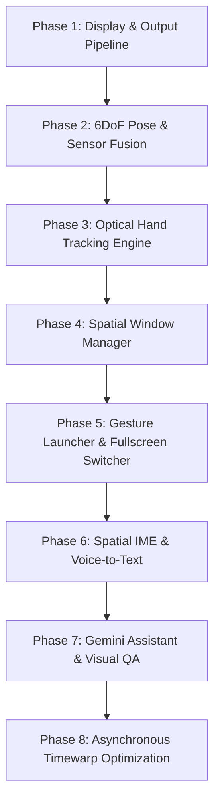
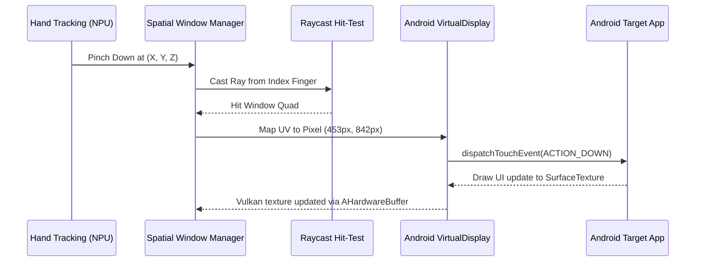
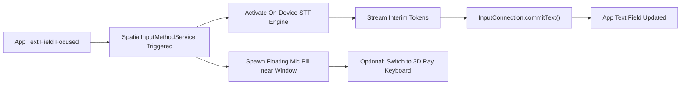
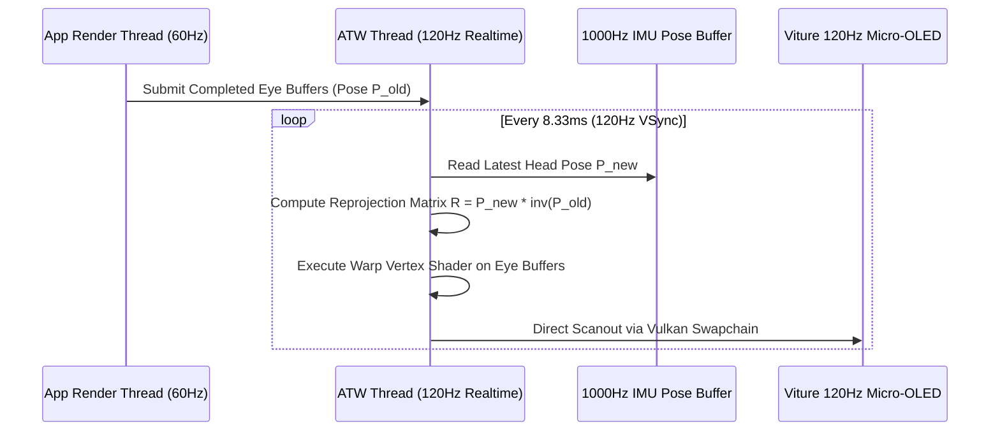

# Android XR Spatial Desktop: Detailed Implementation Plan
**Target Hardware:** Samsung Galaxy Fold (Snapdragon 8 Gen 3/4) & VITURE Luma Ultra 6DoF Glasses  
**Architecture:** Android Userspace Spatial Compositor + Native Vulkan 1.3 + OpenXR/Jetpack XR Shim

---

## 1. Project Scaffolding & Directory Structure

We structure the application as a single high-performance hybrid Android project combining modern Kotlin UI/Services with native C++20 for Vulkan rendering, USB communication, and sensor fusion.

```
SpatialXRDesktop/
├── app/
│   ├── build.gradle.kts
│   ├── src/main/
│   │   ├── AndroidManifest.xml
│   │   ├── java/com/spatial/xr/
│   │   │   ├── MainActivity.kt                      // Entry point, permission orchestrator
│   │   │   ├── display/
│   │   │   │   ├── ExternalDisplayManager.kt        // USB-C DP Alt Mode & DeX bypass
│   │   │   │   └── PresentationManager.kt           // Android Presentation lifecycle
│   │   │   ├── window/
│   │   │   │   ├── SpatialWindowManager.kt          // 3D window transform & hierarchy
│   │   │   │   ├── VirtualDisplayHost.kt            // VirtualDisplay instance pool
│   │   │   │   ├── WindowInputInjector.kt           // Ray-to-UV touch event injection
│   │   │   │   └── AppLauncherRepository.kt         // PackageManager query & grid model
│   │   │   ├── ime/
│   │   │   │   ├── SpatialInputMethodService.kt     // Custom system IME service
│   │   │   │   └── DictationEngine.kt               // On-device STT -> InputConnection
│   │   │   ├── ai/
│   │   │   │   ├── GeminiSpatialAgent.kt            // Gemini 2.0 Flash client & function calling
│   │   │   │   ├── VisualQAPipeline.kt              // UVC frame grabber + multimodal prompt
│   │   │   │   └── SpatialTTSManager.kt             // Audio TTS to glasses temple speakers
│   │   │   └── bridge/
│   │   │       └── NativeBridge.kt                  // JNI interface to native core
│   │   ├── cpp/
│   │   │   ├── CMakeLists.txt
│   │   │   ├── main_jni.cpp                         // JNI bindings
│   │   │   ├── graphics/
│   │   │   │   ├── vulkan_compositor.hpp/.cpp       // Vulkan 1.3 dual-eye swapchain
│   │   │   │   ├── multiview_pipeline.hpp/.cpp      // VK_KHR_multiview stereo rendering
│   │   │   │   ├── atw_reprojector.hpp/.cpp         // Asynchronous TimeWarp pipeline
│   │   │   │   └── quad_renderer.hpp/.cpp           // 3D curved/planar window mesh
│   │   │   ├── hardware/
│   │   │   │   ├── viture_device.hpp/.cpp           // USB HID control & 3D SBS toggle
│   │   │   │   ├── imu_worker.hpp/.cpp              // 1000Hz HID reader thread
│   │   │   │   └── uvc_streamer.hpp/.cpp            // Linux V4L2 / libuvc stereo frame capture
│   │   │   ├── tracking/
│   │   │   │   ├── vio_pose_fusion.hpp/.cpp         // 6DoF sensor fusion (IMU + Optical)
│   │   │   │   ├── pose_predictor.hpp/.cpp          // Latency compensation & extrapolation
│   │   │   │   └── hand_tracking_qnn.hpp/.cpp       // MediaPipe Hands on Snapdragon NPU
│   │   │   └── openxr/
│   │   │       └── openxr_shim.hpp/.cpp             // OpenXR 1.1 runtime dispatch tables
│   │   └── assets/
│   │       ├── models/
│   │       │   ├── palm_detector.tflite             // QNN quantized palm detection
│   │       │   └── hand_landmarks.tflite            // 21-point 3D landmark regressor
│   │       └── shaders/
│   │           ├── window_quad.vert/.frag           // Window surface rendering
│   │           ├── curved_cinema.vert/.frag         // Cylindrical 90-degree cinema screen
│   │           ├── hand_mesh.vert/.frag             // Laser pointer & joints
│   │           └── atw_warp.vert/.frag              // Reprojection timewarp shader
```

---

## 2. Phase-by-Phase Implementation Specifications



---

### Phase 1: Hardware Abstraction & Display Pipeline (Fold ↔ Viture)
**Goal:** Establish low-latency, tear-free stereo rendering to the glasses at 3840x1080 @ 120Hz via USB-C DisplayPort Alternate Mode.

#### Task 1.1: DeX Bypass & Display Detection
* Implement `ExternalDisplayManager.kt` registering `DisplayManager.DisplayListener`.
* Monitor display addition with flag `Display.FLAG_PRESENTATION`.
* Check USB device VID (`0x35CA` for VITURE) and product name.
* In Samsung One UI, DeX auto-starts on external display connect.
  * **Programmatic Mitigation:** Register the presentation display immediately before DeX acquires the surface. Provide an in-app prompt and ADB guideline (`settings put global dex_auto_start_with_hdmi 0`).

#### Task 1.2: Viture Hardware Control & 3D SBS Switching
* Create `viture_device.cpp` interfacing with the USB HID control endpoint (`endpoint 0x01` / `0x81`).
* Send vendor control packet to switch the Micro-OLED controllers from 2D mirror to 3D Side-by-Side:
  ```cpp
  // VITURE Vendor command for 3D Side-by-Side (3840x1080)
  uint8_t cmd_enable_3d_sbs[64] = {0x00, 0xA1, 0x01, 0x01 /* 3D SBS ON */};
  libusb_control_transfer(handle, 0x21, 0x09, 0x0300, 0x00, cmd_enable_3d_sbs, sizeof(cmd_enable_3d_sbs), 500);
  ```
* Handle connection hot-plugging and revert to standard 2D mode when session terminates.

#### Task 1.3: Native Vulkan 1.3 Stereo Swapchain
* Implement `vulkan_compositor.cpp` using `ANativeWindow_fromSurface()` acquired from an Android `Presentation` surface on the external display.
* Enumerate physical device features: require `VK_KHR_multiview`, `VK_KHR_swapchain`, `VK_KHR_incremental_present`.
* Configure swapchain format: `VK_FORMAT_R8G8B8A8_SRGB` with presentation mode `VK_PRESENT_MODE_FIFO_KHR` or `VK_PRESENT_MODE_MAILBOX_KHR`.
* Viewport configuration:
  * Framebuffer: $3840 \times 1080$.
  * Left Eye Viewport: $X=0, Y=0, W=1920, H=1080$.
  * Right Eye Viewport: $X=1920, Y=0, W=1920, H=1080$.
* **Verification:** Render stereo color calibration pattern (pure red left, pure cyan right). Wearing glasses shows solid white binocular fusion with zero crosstalk.

---

### Phase 2: 6DoF Pose & Sensor Fusion Engine
**Goal:** Deliver 6DoF head tracking coordinates ($x, y, z, q_w, q_x, q_y, q_z$) with $< 5\text{ ms}$ sensor latency.

#### Task 2.1: 1000Hz USB HID IMU Worker Thread
* Launch high-priority native thread with Linux real-time priority:
  ```cpp
  pthread_attr_setschedpolicy(&attr, SCHED_FIFO);
  sched_param param{.sched_priority = 85};
  pthread_attr_setschedparam(&attr, &param);
  ```
* Read continuous 64-byte raw HID reports: 3-axis gyroscope ($rad/s$), 3-axis accelerometer ($m/s^2$), and timestamp ($\mu s$).
* Apply calibration biases and integrate angular velocity into orientation quaternion $Q(t)$.

#### Task 2.2: UVC Video Pipeline & Visual-Inertial Odometry (VIO)
* Open the Viture stereo tracking cameras using Linux `v4l2` streaming (`/dev/videoX`) at $640 \times 480$ @ 60 FPS.
* Implement feature extraction (FAST corners) and Lucas-Kanade optical flow on Adreno compute or Snapdragon NPU.
* Fuse visual translation vectors with double-integrated accelerometer data via an Error-State Extended Kalman Filter (ES-EKF).

#### Task 2.3: Pose Predictor & Late-Latching Ring Buffer
* Implement lock-free circular buffer storing past 128 poses with nanosecond hardware timestamps.
* Calculate forward prediction $t_{render} = t_{now} + \Delta t_{vsync} + \Delta t_{scanout}$.
* Extrapolate orientation using current angular velocity:
  $$Q_{pred} = Q_{curr} \otimes \exp\left(\frac{1}{2} \vec{\omega} \Delta t\right)$$
* **Verification:** Move head rapidly in 6DoF. World-anchored virtual grid stays rock-solid against physical room features with zero perceptible lag.

---

### Phase 3: Optical Hand Tracking & Gesture Engine
**Goal:** Track 21 3D hand joints at 60 FPS on Snapdragon NPU and translate gestures into spatial UI actions.

#### Task 3.1: Dual-Camera Frame Feed & NPU Acceleration
* Pipe UVC tracking camera frames directly to Qualcomm QNN (Snapdragon NPU) runtime via zero-copy `AHardwareBuffer`.
* Load quantized MediaPipe models:
  * `palm_detector.tflite`: Run every 10 frames or when tracking lost (inference time $< 4\text{ ms}$).
  * `hand_landmarks.tflite`: Run every frame on cropped hand bounding box (inference time $< 3.5\text{ ms}$).
* Reconstruct 21 3D joint positions relative to head coordinate space.

#### Task 3.2: Spatial Pointer & Gesture Recognizer
* **Index Pointer Ray:**
  * Ray Origin: Midpoint between wrist (joint 0) and index MCP (joint 5).
  * Ray Direction: Vector pointing from index MCP (joint 5) through index tip (joint 8).
* **Pinch Gesture Classifier:**
  * Calculate Euclidean distance $d = \|\vec{P}_{\text{index\_tip}} - \vec{P}_{\text{thumb\_tip}}\|$.
  * Hysteresis thresholds: $d < 20\text{ mm} \implies \text{Pinch Down}$; $d > 28\text{ mm} \implies \text{Pinch Up}$.
* **Two-Hand Scale Detector:**
  * Detect simultaneous pinch on both hands.
  * Compute delta distance between hands to drive window resizing.
* **Look-at-Palm Detector:**
  * Compute palm normal: $\vec{N}_{\text{palm}} = (\vec{P}_{\text{index\_mcp}} - \vec{P}_{\text{wrist}}) \times (\vec{P}_{\text{pinky\_mcp}} - \vec{P}_{\text{wrist}})$.
  * Test alignment with head gaze: $\vec{N}_{\text{palm}} \cdot \vec{V}_{\text{gaze}} < -0.75$.
* **Verification:** Hand skeleton renders over real hands in pass-through view. Pinching accurately selects target buttons with zero false positives during resting hand movements.

---

### Phase 4: Spatial Window Manager & VirtualDisplay Pipeline
**Goal:** Render multi-window Android applications in 3D space with interactive resize and touch injection.



#### Task 4.1: Multi-Instance `VirtualDisplay` Pool
* Implement `VirtualDisplayHost.kt` utilizing `DisplayManager.createVirtualDisplay()`.
* Back each `VirtualDisplay` with a `SurfaceTexture` / `Surface` linked to an `AHardwareBuffer`.
* Allocate displays dynamically: default size $1280 \times 720$ @ 320 DPI.
* Host target apps inside tasks using `ActivityOptions.setLaunchDisplayId()`.

#### Task 4.2: 3D Window Mesh & Coordinate Transformations
* Create `SpatialWindow` class holding:
  * Model Matrix $M_{world} \in \mathbb{R}^{4 \times 4}$.
  * Anchor Mode: `WORLD_LOCKED` or `FLOATING`.
  * Dimensions: Width $W$ (meters), Height $H$ (meters).
  * Texture ID and Framebuffer reference.
* **Floating (Follower) Algorithm:**
  * Track user head orientation $Q_{head}$. If angle between window center and forward gaze $> 18^\circ$:
    $$Q_{target} = \text{Slerp}(Q_{window}, Q_{head}, \alpha \cdot \Delta t)$$
  * Maintain comfortable viewing distance ($1.2\text{ m}$).

#### Task 4.3: 4-Corner 3D Resize Handles
* Render 4 interactive grab spheres at quad vertices:
  $$\vec{V}_{top\_left}, \quad \vec{V}_{top\_right}, \quad \vec{V}_{bottom\_left}, \quad \vec{V}_{bottom\_right}$$
* When user pinches a corner handle and drags:
  1. Compute projection of hand delta onto quad plane.
  2. Update quad width $W_{new}$ and height $H_{new}$.
  3. Recompute virtual pixel dimensions:
     $$\text{Width}_{px} = \text{round}(W_{new} \cdot \text{PixelsPerMeter})$$
     $$\text{Height}_{px} = \text{round}(H_{new} \cdot \text{PixelsPerMeter})$$
  4. Call `VirtualDisplay.resize(Width_{px}, Height_{px}, DensityDpi)`. Android applications automatically reflow layout components without restart.

#### Task 4.4: Raycast Intersection & Touch Injection
* In `WindowInputInjector.kt`:
  * Intersect pointer ray $\vec{R}(t) = \vec{O} + t\vec{D}$ with plane containing window quad.
  * Verify intersection point falls within bounds $[-W/2, W/2]$ and $[-H/2, H/2]$.
  * Map intersection to normalized UV:
    $$U = \frac{X_{hit} + W/2}{W}, \quad V = \frac{Y_{hit} + H/2}{H}$$
  * Dispatch simulated `MotionEvent`:
    ```kotlin
    val event = MotionEvent.obtain(downTime, eventTime, action, u * displayWidth, (1f - v) * displayHeight, 0)
    virtualDisplay.display.injectInputEvent(event)
    ```

---

### Phase 5: Spatial App Launcher & Fullscreen Task Switcher
**Goal:** Provide zero-voice gesture-driven application launching and rapid task switching in fullscreen mode.

#### Task 5.1: Look-at-Palm Gesture & Wrist Dock
* When `Look-at-Palm` detector passes threshold, spawn floating wrist anchor button $5\text{ cm}$ above wrist.
* Pinching wrist button expands curved 3D horizontal dock at chest level.
* Enumerate all launchable applications via `PackageManager.queryIntentActivities(Intent(Intent.ACTION_MAIN).addCategory(Intent.CATEGORY_LAUNCHER))`.
* Render icons in a paginated, curved carousel with kinetic inertia scrolling.
* Selecting an app instantiates a new `VirtualDisplay` and spawns its 3D window in front of user.

#### Task 5.2: Fullscreen Curved Virtual Cinema Screen
* Tapping "Maximize" on any window triggers transition animation:
  * Interpolates planar mesh into a cylindrical curved section spanning $90^\circ$ horizontal FOV.
  * Radius: $R = 2.0\text{ m}$.
  * Surrounding windows dim (render with $0.15$ opacity shader uniform).
  * High-priority rendering mode: maximizes Vulkan swapchain throughput for video playback/gaming.

#### Task 5.3: Rapid Task Switcher (Pill & Air-Swipe)
* Place translucent indicator pill at bottom center of FOV.
* **Glance/Point Interaction:** Glancing down at pill expands live 3D thumbnail previews of all open apps.
* **Air-Swipe Gesture:**
  * Detect rapid horizontal hand swipe (hand velocity $v_x > 1.2\text{ m/s}$ with index extended).
  * Instantly transition the current fullscreen surface to the next active application in the MRU (Most Recently Used) stack.
* **Exit Fullscreen:** Pinching the top-center "Minimize" handle returns the app to its original floating/anchored position.

---

### Phase 6: Spatial IME & Voice-to-Text Dictation
**Goal:** Deliver automated, zero-friction speech-to-text dictation whenever an input text box is focused.



#### Task 6.1: Custom `SpatialInputMethodService`
* Register service in `AndroidManifest.xml` with `BIND_INPUT_METHOD` permission.
* Override `onStartInput(info, restarting)` and `onStartInputView(info, restarting)`.
* Identify target window position from the `VirtualDisplay` ID reported by the input binding.

#### Task 6.2: Floating Dictation Pill UI
* Render a floating frosted-glass mic widget directly under the active window's bottom frame.
* Animate audio waveform bars reflecting input microphone volume amplitude.
* Include 3 action buttons:
  1. `Clear` (sends `KEYCODE_DEL` loop).
  2. `Enter / Search` (sends `IME_ACTION_DONE` / `KEYCODE_ENTER`).
  3. `Keyboard Toggle` (spawns 3D spatial ray-interactive QWERTY keyboard).

#### Task 6.3: Speech-to-Text Engine & Injection
* Initialize on-device speech recognizer via Android `SpeechRecognizer` (or on-device Whisper Tiny compiled via QNN).
* Pipe audio directly from Viture glasses microphone array.
* On incoming transcribed tokens:
  ```kotlin
  currentInputConnection.setComposingText(interimText, 1)
  ```
* On sentence boundary or $1.5\text{ s}$ pause:
  ```kotlin
  currentInputConnection.commitText(finalText, 1)
  ```

---

### Phase 7: Gemini Spatial Assistant & "Look & Ask" Visual QA
**Goal:** Seamless voice-controlled workspace management and multimodal vision QA using Viture camera frames.

#### Task 7.1: Background Voice Daemon & Hotword
* Keep low-power audio listener active on Fold using Voice Activity Detection (VAD).
* Wake triggers: Keyword "Hey Gemini", physical short-press of Viture frame button, or 3-finger air tap.

#### Task 7.2: Function Calling Tool Router
* Connect to Gemini 2.0 Flash API (or on-device Gemini Nano via Android AICore).
* Register structured tool declarations:
  * `launch_app(package_name, anchor_mode, position_preset)`
  * `reposition_window(window_id, action)`
  * `organize_workspace(layout_style)`
  * `analyze_screen_or_scene(query)`
* Execute tool invocations on Android main thread:
  ```kotlin
  fun executeSpatialTool(call: ToolCall) {
      when (call.name) {
          "launch_app" -> windowManager.launchApp(call.args.getString("package_name"))
          "organize_workspace" -> windowManager.reorderWindows(call.args.getString("layout_style"))
      }
  }
  ```

#### Task 7.3: Multimodal "Look & Ask" Pipeline
* When user says "What am I looking at?" or asks for visual instructions:
  1. `uvc_streamer` grabs the current $1920 \times 1080$ uncompressed RGB frame from the pass-through camera.
  2. Compress frame to memory as WebP ($85\%$ quality, $\sim 80\text{ KB}$).
  3. Dispatch payload with prompt to Gemini 2.0 Flash:
     ```json
     {
       "contents": [{
         "parts": [
           {"text": "You are a spatial assistant. The user is looking at this image through AR glasses. Answer concisely in 2 sentences max."},
           {"inline_data": {"mime_type": "image/webp", "data": "<BASE64>"}}
         ]
       }]
     }
     ```

#### Task 7.4: Dual Output: 3D Text Overlay + Spoken TTS
* **3D Text Card:**
  * Spawns a floating semi-transparent card at eye level $1.5\text{ m}$ ahead.
  * Streams Gemini response tokens directly to card text surface.
* **Audio Voice Output:**
  * Feed streamed text to Android `TextToSpeech` engine.
  * Direct audio stream to external audio device (Viture glasses open-ear speakers).
* Dismiss automatically after $10\text{ s}$ of inactivity or with hand pinch gesture.

---

### Phase 8: Asynchronous TimeWarp (ATW) & System Latency Optimization
**Goal:** Decouple display refresh ($120\text{ Hz}$) from app rendering ($60\text{ Hz}$) and bring Motion-to-Photon latency under $18\text{ ms}$.



#### Task 8.1: Dedicated Real-Time ATW Thread
* Create separate Vulkan rendering context with `EGL_CONTEXT_PRIORITY_REALTIME_NV` or Vulkan priority `VK_QUEUE_GLOBAL_PRIORITY_REAL_TIME_EXT`.
* Run thread at strict $120\text{ Hz}$ tied to `VK_KHR_display` or Android VSync.

#### Task 8.2: Reprojection Matrix & Warp Shader
* Compute relative rotational offset between rendering pose $P_{render}$ and presentation pose $P_{present}$:
  $$M_{warp} = P_{present} \cdot P_{render}^{-1}$$
* Apply 4-corner mesh warping in `atw_warp.vert` shader to shift completed eye textures before hardware scanout.
* Eliminates perceived latency even if an underlying app drops frames.

---

## 3. Verification Matrix & Test Criteria

| Phase | Test Case | Success Criteria | Tool / Benchmark |
| :--- | :--- | :--- | :--- |
| **Phase 1** | Stereo Display Calibration | Pure white binocular fusion; zero crosstalk; solid 120 FPS | RenderDoc / Systrace |
| **Phase 2** | 6DoF Pose Stability | Head translation produces accurate 1:1 parallax; $< 0.5\text{ cm}$ drift | Visual spatial marker overlay |
| **Phase 3** | Hand Tracking Accuracy | Joint tracking remains locked on fingers; pinch latency $< 15\text{ ms}$ | Snapdragon Profiler / QNN trace |
| **Phase 4** | Window Resizing & Input | Corner drag reflows app UI smoothly; touch coordinates align with finger ray | Multi-touch visualizer APK |
| **Phase 5** | Launcher & Task Switcher | Palm-up spawns dock within $100\text{ ms}$; air-swipe switches fullscreen instantly | Video analysis @ 120 FPS |
| **Phase 6** | Voice-to-Text Dictation | Focusing text box activates mic; spoken words stream with $< 400\text{ ms}$ delay | Android SpeechRecognizer benchmark |
| **Phase 7** | Look & Ask Visual QA | Frame capture + Gemini response card visible within $1.2\text{ s}$; audio plays from glasses | Network latency & token logger |
| **Phase 8** | Motion-to-Photon Latency | Head rotation to photon update latency measured under $18\text{ ms}$ | High-speed 240 FPS camera |

---

## 4. Implementation Schedule

```
Phase 1: Display Pipeline & Vulkan 1.3         [████████░░░░░░░░░░░░] Days 1 - 3
Phase 2: 6DoF IMU & VIO Fusion                [░░░░░░░░████░░░░░░░░] Days 4 - 6
Phase 3: Optical Hand Tracking (NPU)          [░░░░░░░░░░░░████░░░░] Days 7 - 10
Phase 4: Spatial Window Manager & Input       [░░░░░░░░░░░░░░░░████] Days 11 - 14
Phase 5: Gesture Launcher & Fullscreen        [░░░░░░░░░░░░░░░░░░██] Days 15 - 17
Phase 6: Spatial IME Dictation                [░░░░░░░░░░░░░░░░░░██] Days 18 - 19
Phase 7: Gemini Assistant & Visual QA         [░░░░░░░░░░░░░░░░░░██] Days 20 - 22
Phase 8: Asynchronous TimeWarp & Polish       [░░░░░░░░░░░░░░░░░░██] Days 23 - 25
```
